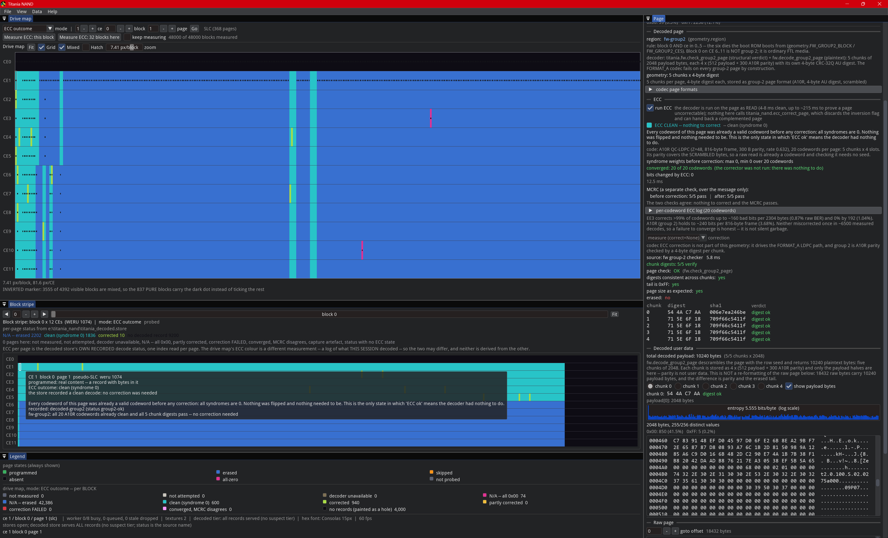

# nandgui — the Titania NAND viewer

An interactive viewer for a Titania NAND capture: a whole-drive map
(12 CEs x 4000 blocks), a per-block page stripe across all CEs, and a page
inspector with raw hex, the decoded page **in its own region's geometry**
(4 AUs behind a 6-byte MCRC, or 5 chunks behind 4-byte digests), entropy and a
byte histogram.

[](screenshot.png)

*Click for full resolution.* Left, top to bottom: the **drive map**, twelve CEs
of 4000 blocks coloured by ECC outcome with all 48000 measured; the **block
stripe**, block 0 across every CE, with the hover tooltip that explains one
page's verdict in full; and the **legend**, which names every state and how many
blocks are in it. Right: the **page inspector**, here on a `fw-group2` page it
has decoded as five A10R chunks — every one of the 20 codewords already a valid
codeword before correction, all five chunk digests verified, and the decoded
payload shown with its entropy histogram and hex.

It is a **reading** tool. It opens both stores read-only, never writes a page,
and never modifies the capture.

## Run it

```
py -3 path/to/nandgui/main.py
```

Equivalently, from the directory containing the package: `py -3 -m nandgui`.

### Where it looks for data

Nothing is compiled in. Paths resolve at import, most explicit first:

| what | how |
|---|---|
| `--raw` / `--decoded` / `--summary` | the command line wins over everything |
| `$TITANIA_RAW_STORE`, `$TITANIA_DECODED_STORE` | pin one store each |
| `$TITANIA_NAND_DIR` | the directory holding the stores and `summary.npz` |
| — | otherwise the working directory |

Inside that directory a store is found by CONVENTION first (`raw.store`,
`decoded.store`) and then BY SHAPE — any directory whose `store.json` declares
`page_bytes` 18432 is a raw store and 16416 a decoded one. Shape is the reliable
test, because a store's name is whatever the build that made it chose, and the
two page sizes cannot be confused: `DumpDevice` refuses to open a store whose
`page_bytes` disagrees with what the caller expects.

Shape cannot tell two GENERATIONS of the same role apart, and a working
directory routinely holds several. So every candidate is recorded, and if more
than one qualified the viewer prints which it opened and what else was there:

```
decoded store: using /data/decoded.store  (2 other stores of this shape here:
decoded-v2.store, merged-decoded.store).  Pin one with --decoded or
$TITANIA_DECODED_STORE.
```

`titania` itself must be importable — `pip install -e .` from its checkout, or
`$TITANIA_PKG` pointing at the directory that contains the package.

### Options

```
--summary PATH      per-block summary npz, built by `titania summary`
--raw PATH          raw page store,     page_bytes 18432
--decoded PATH      decoded page store, page_bytes 16416
--include-suspect   serve pages a store quarantined in a "suspect" tier.
                    Only meaningful for a store that DECLARES such a tier; the
                    status bar says whether this one does, and if it does not,
                    the toggle governs nothing
--workers N         worker threads, each with its own pair of open stores
--self-test N       draw N frames into a hidden window and exit; a build check
                    that needs no display. It also asserts the palette
                    separation invariant described below
```

Smoke check without opening a window:

```
py -3 -c "import sys; sys.path.insert(0, 'path/to/nandgui'); import main"
py -3 -m nandgui --self-test 20
```

**`summary.npz` is optional**, and it is a CACHE of what the stores say. Without
it the drive map says exactly what is missing and the block stripe and page
inspector still work, because they read the stores directly. **Rebuild it
whenever you rebuild a store** (`py -m titania.summary`): the map shades from it
and, unlike the block panel, carries no label saying the numbers are old, so a
stale summary quietly disagrees with the page inspector beside it.

Never launch it while something is writing a store — the index is mmapped.

---

## THE FIVE PAGE STATES — and why they are never merged

This is the correctness requirement of the whole tool, not a styling
preference. Every view, every legend, every tooltip keeps these five apart:

| state | what it means |
|---|---|
| **programmed** | real content: a record with bytes in it |
| **erased** | the media reads 0xFF — a **zero-length record that EXISTS**. We looked, and it was blank |
| **skipped** | deliberately not read, with a recorded reason. `read_page()` **raises**. Nothing here says what the media holds |
| **absent** | **no record at all — we never looked.** A HOLE in the dump, not clean media |
| **all-zero** | uniform 0x00: the dead-CE bus constant, **NOT erased media** (erased NAND reads 0xFF) |

A sixth *rendering* state, **not probed**, means the worker has not classified
those pages yet. It has its own colour too, so a stripe still loading can never
be mistaken for erased media.

**Why this matters:** this project has twice drawn a wrong conclusion by
merging these. 190 MB of 0x00 were reported as content (all-zero merged into
programmed), and a metadata-driven skip nearly lost the boot block (skipped
merged into erased). A viewer that renders *skipped* as *erased*, or *absent*
as blank media, recreates those errors in a form that looks authoritative —
which is worse than not having a viewer.

So the tool holds itself to these rules:

* **The five-state legend is pinned on screen in every colour mode**, with
  counts, including counts of zero. A state that can vanish from the legend can
  vanish from the reader's thinking.
* **A colour is a pointer, never the claim.** Whenever a cell stands for many
  pages (a block on the map) or many cells (a pixel at low zoom), the exact
  per-state counts are printed as text next to it, and the reduction is stated
  in numbers.
* **Rare and dangerous beats common.** When several states share one cell or
  one pixel, the *rarest* wins it: skipped > absent > all-zero > programmed >
  erased. One skipped page can never hide inside a block that reads as clean,
  and one skipped block can never be dropped between pixels. Mixed blocks are
  additionally marked (tick / inverted dot / hatch, whichever is legible at
  that zoom — the marker degrades but never silently disappears).
* **Sentinels never join a ramp.** `weru == -1`, `owner == -1`, `binid == -1`
  or `53`, `erases == -1` all paint as the neutral "no value" colour. An
  unknown erase count must never look like "erased zero times".
* **A block with no records is a hole in every mode**, including the modes
  coloured from metadata. CE0 is dead and carries a full set of WERU / owner /
  erase-count claims; painting those claims as observations is exactly the
  failure above.
* **Nearest sampling only, and reduce in numpy first.** Two adjacent NAND cells
  are never blended — an interpolated pixel between *programmed* and *absent*
  is a colour that means nothing.
* **No blending over data.** Everything drawn *on top of* a cell — grid lines,
  CE separators, the hover box, the selection ring, the mixed tick, the pure
  dot, the hatch — is **opaque**. A translucent overlay does not "tint" a cell,
  it **invents a colour that is in no legend**: white at 16% over *skipped*
  (255,148,24) produces (255,165,60), which the reader can look up nowhere and
  which reads as a sixth state. The same defect arrives by three routes and all
  three are closed: an **alpha constant** below 255, an **anti-aliased stroke**
  (`add_rect`/`add_line` spread a 1 px edge as partial coverage even at
  alpha 255 — hence `mapview.stroke_rect`, four snapped quads, and the
  `_no_aa_lines` scope for the two genuinely diagonal marks), and a **line on a
  fractional coordinate** (a 1 px line at x.5 splits its alpha across two
  columns). Overlays drawn *outside* the canvas — legend swatches, gutter
  labels, footers — may keep their alpha; nothing is measured there.
  `--self-test` enforces this: `app._canvas_purity_problems` reads both canvases
  back out of the framebuffer every frame and **fails the build** on any pixel
  that is neither a colour of the image uploaded that frame nor one of the
  overlay colours the view *declares* in `mapview.OVERLAY_COLORS` /
  `blockview.OVERLAY_COLORS`. Adding an overlay without declaring it fails too —
  the declaration is the legend's copy of the truth.
* **Mode colours are held ≥ 25 CIELab ΔE from every state colour**, because the
  state legend is on screen beside them. `--self-test` fails the build if that
  is violated (`palette._check_mode_color_separation`).

MCRC is likewise **three-valued** and never rounded to a pass: *pass* / *FAIL* /
*not recorded*. A page served out of the decoded store carries the page-level
verdict the store recorded, and there are two ways a store can record it.

An older store puts the verdict in *which tier the record lives in*, so turning
the suspect tier on adds information and never replaces a failure with
"unknown". A newer one puts it in the record's **source name**, expanded by
`store.json["status_vocabulary"]` — one name per decode status, all of them
served — which `model._status_vocabulary()` reads, so the panel prints the
store's own words about its own record rather than a two-way guess.

A store with no vocabulary still renders, but every page falls back to "no MCRC
verdict recorded": readable, and quietly less informative. If you build a
decoded store, write the vocabulary into it.

---

## Page geometry varies by region

**A page on this die does not have one layout. It has three regions with two
geometries, and the CE is half of the address that decides which.** Decoding a
region with the wrong geometry does not fail loudly — it produces a confident
verdict about a layout the bytes do not have, so **valid pages look corrupt**.
That is not hypothetical: `decoded.store` decoded the whole drive as 4 AUs
behind a 6-byte MCRC, and every `fw-group2` page therefore came out
"MCRC FAIL 0/4". Measured with the region's own checker, **1,835 of those 1,840
pages verify 5/5** and the other 5 verify 4/5. The viewer used to paint all of
them red.

So every read dispatches on `titania.geometry.region(ce, block)`, wrapped by
`pagefmt.region_of`, and nothing re-derives a region from the block number.

| region | addressing rule | geometry | decoder |
|---|---|---|---|
| **`fw-group2`** | block 0 **and** CE 0..5 (`geometry.FW_GROUP2_BLOCK` / `FW_GROUP2_CES`) — the six dies the boot ROM boots from | **5 chunks × 4-byte digest** | `fw.check_group2_page` (verdict) + `fw.decode_group2_page` (plaintext) |
| **`fw-group01`** | blocks 6,7 (fw group 0) and 8,9 (fw group 1), on **every** CE | 4 AUs × 6-byte MCRC | the FORMAT_A codec — measured MCRC-clean 4/4 here |
| **`ftl`** | every other (ce, block): the main media, most of the drive | 4 AUs × 6-byte MCRC | the FORMAT_A codec |

**Block 0 on CE 6..11 is `ftl`, not group 2** — measured, ce6/b0/p0 decodes
FORMAT_A 4/4. A region map that read the block number alone would feed six
dies' worth of ordinary media to the five-chunk reader, which is why the CE is
never optional and the region is always *asked for*.

### The four codec formats

`titania.codec` knows four. The MCRC **width** is what says how wide a verdict
is: a 4-byte and a 6-byte MCRC are not the same check.

| format | MCRC | ECC | scrambling | used for |
|---|---|---|---|---|
| **FORMAT_A** | 6-byte | EE3 LDPC | scrambled | main media (`ftl`, `fw-group01`) |
| **FORMAT_B** | 4-byte | A10R (512×4) | scrambled | firmware images |
| **FORMAT_C** | **none at all** | none | not scrambled | raw / long reads |
| **FORMAT_D** | 4-byte | as A (EE3 LDPC) | scrambled | RAID parity, read path only |

FORMAT_C has no MCRC, so it *cannot fail one* — and that absence of a failure is
not evidence of a good page. The inspector prints this table behind the
**codec page formats** header next to the region banner.

### What a group-2 page actually is

Five chunks, each **2048 payload bytes** carried as 4 × (512 payload + 300 A10R
parity), each chunk with **its own 4-byte CRC-32Q digest**. There is no 4-AU
view of such a page and no 6-byte MCRC anywhere in it, so the inspector draws
the five chunks with their digests, `digest_consistent`, `tail_ff`, `size`,
`erased`, the reader's notes, and the `(n_ok, n_total)` roll-up — and never the
words "MCRC FAIL". Three verdict rules follow from the shape:

* an **erased** chunk carries no digest to check, so it is counted in neither
  number; five erased chunks give `(0, 0)` — *none checked*, which is neither a
  pass nor a failure;
* `page check` (the checker's whole-page verdict, which also covers the tail and
  digest consistency) is reported separately from the digest roll-up;
* a page nobody asked a decoder about — ABSENT, ERASED, SKIPPED, not probed —
  says *not decoded*, never "the reader could not be reached". All 368 pages of
  CE0's block 0 are such pages.

### The aux bytes: 8 wide in every layout

Every AU carries **8 aux bytes** (`aux.AUX_BYTES`, 4 AUs per page), but what
those bytes *mean* depends on a layout id that is **not in the bytes**: it is
descriptor byte **+17** of the **owning MSO** (`aux.MSO_DESC_AUX_LAYOUT_OFF`),
per-drive configuration.

| layout | firmware name |
|---|---|
| 0 | `cAuxLayoutForInternalData` |
| **1** | **none — this firmware does not name it** |
| 2 | `cAuxLayoutForForNSID23` |
| 3 | `cAuxLayoutForRaidParityMso` |

Layout 1 renders as **“1 (unnamed in this firmware)”** and a name is never
invented for it. nandgui carries **no MSO descriptor source**, so
`aux.layout_for` answers `UNKNOWN` and the inspector says **“layout UNKNOWN”** —
never a default of 0. The 8 bytes are still shown as hex; what is withheld is a
set of confident field names for fields that may not be there.

### Pages per block

Two block shapes coexist and the count is never assumed — it comes from
`summary.npz`'s `slc` flag per block:

| cell mode | pages per block |
|---|---|
| pseudo-SLC | **368** |
| native TLC | **1104** |

### Where this shows up in the UI

* the **page inspector** leads with the region, the addressing rule that put the
  page there, the decoder that ran and that decoder's check geometry;
* **hover text** (`describe_block` / `describe_page`) names the region and its
  geometry as part of the address;
* the **Decoded MCRC** map mode gives `fw-group2` blocks their own class and
  colour — *decoded under the wrong geometry (NOT a verdict)* — instead of
  counting them under "all failed" in the same red as real damage;
* the **Data menu** tooltip says how many of the suspect-tier pages are group-2
  pages quarantined by construction, and that the toggle does not govern them
  (the inspector re-decodes group-2 records from raw in either tier).

---

## Colour modes

Pick one from the mode selector above the map (or the View menu). The
five-state legend stays pinned underneath in all of them.

| mode | colours by |
|---|---|
| **Content** | the five page states, per block, by the precedence above |
| **Cell mode** | pseudo-SLC (368 pages) vs native TLC (1104 pages) |
| **WERU** | wear/erase unit id, hashed to a stable hue |
| **Owner** | owning MSO; `-1` uses the sentinel colour |
| **WERU bin** | bin id; bin 53 means "in no bin" and uses the sentinel colour |
| **Erase count** | heat ramp; `-1` (unknown) is the sentinel, never the low end |
| **Defect / status** | defect / status code from the WERU table |
| **Decoded MCRC** | per block: none decoded / all clean / mixed / all failed / **decoded under the wrong geometry** (the `fw-group2` blocks — see above; that tally is `decoded.store`'s and is not a verdict about the media) |
| **ECC outcome** | what the **ECC decoder** did, per block, on the pages actually measured — see the section below. Blocks nobody has decoded say *not measured*, in their own colour |

---

## ECC is a different verdict from the MCRC, and the viewer shows both

The MCRC is a CRC over one unit's stored **message**. The ECC is an LDPC decode
of the **codewords** that message is carried in. They cover different bytes and
they can disagree in both directions, so neither is ever computed from the
other and neither stands in for the other on screen.

Measured on this capture, all three of these really happen:

* a page whose five group-2 digests verify **5/5** while a codeword still
  carries a flipped bit — the flip is in LDPC **parity**, which the digest's
  message does not cover (5 of the 10 dirty codewords on this drive, and the
  decoded store serves those five pages as clean);
* a page whose MCRC fails and whose ECC repairs it completely — 172 of 250
  sampled "failed" ftl pages are fully recovered by the decoder already in the
  package;
* a page where **neither** helps: 0 of 8 codewords converge, 0 bits change, and
  the implied raw BER (1.8–4.3%) is 2–4× past the corrector's measured
  waterfall (0.92%). Those need a re-**READ** with the retry ladder, not a
  different decoder — 15 of 15 such addresses that have a retry capture decode
  clean from it.

**That third prediction has been tested at scale and it held.** A ladder pass
re-read 316,949 addresses on the board at shifted read references and every one
of them decodes: 314,106 `ecc-corrected` + 2,843 clean, **0 failures** —
verified by re-running `pagefmt.ecc_of_page` over the stored bytes rather than
by trusting the run's own tally. Nothing about the decoder changed; only the
read did.

### The ten ECC states, never merged

`pagefmt.EccState`, one colour each in `palette.ECC_RGBA`, one legend row each,
and each with its own sentence in the inspector:

| state | means |
|---|---|
| **not measured** | nobody ran the decoder over this block (the map's default) |
| **not attempted** | the page carries no bytes, or the run-ECC toggle is off |
| **decoder unavailable** | the LDPC modules could not be reached — about this machine, not the media |
| **N/A — all 0x00** | the zero page IS the zero codeword: syndromes are 0 *by construction* and say nothing |
| **N/A — erased** | 0xFF is not data |
| **clean (syndrome 0)** | already a valid codeword on every codeword; nothing to correct |
| **corrected** | nonzero syndrome, all codewords converged, MCRC agrees afterwards |
| **partly corrected** | some codewords converged and some did not |
| **correction FAILED** | the decoder ran on every codeword and converged on none |
| **converged, MCRC disagrees** | a RED FLAG: never observed here (0 of 248 failing pages, 0 of 264 injections, 0 of 36,800 group-2 codewords), so read it as a bug in the decode path |

### ECC by page class — the rule, and what can come out of it

There is no single "run ECC" for this drive. Which decoder is correct is decided
by `geometry.region(ce, block)` and by the cell mode, and applying the wrong one
does not fail loudly — it produces a confident wrong answer. `pagefmt.ecc_of_page(raw, ce, block, page)`
dispatches on exactly this table. Two tests run **before** any decoder, in this
order, because the corrector misbehaves on both fills: all-`0x00`, then all-`0xFF`.

| class | how it is recognised | the rule | outcomes measured on this capture |
|---|---|---|---|
| **zero block** | `raw.count(0x00) == 18432` — exact drive-wide: 53,736 pages in 74 blocks, no partial members and no all-zero page anywhere else | **no decode at all.** The zero page *is* the zero codeword under the deep convention, so all 8 syndromes are 0 *by construction* and "converged, 0 flips" carries no information | one: `N/A — all 0x00`. 53,736/53,736. Never correctable and never uncorrectable — there is nothing to correct. Every containing WERU has `valid_count = 0`, so no user data is behind them |
| **pseudo-SLC ftl** | `cellmap == "slc"` and region `ftl` | FORMAT_A / EE3, `nd_deepparity.decode_page` on the page as read, status from the 8-entry per-codeword log and the pre-correction syndromes | `clean` / `erased` / `all-0x00`. **0 failures** in 50,312 store pages and in a 412-page independent sample. Headroom if it ever degrades: 100% exact to 168 bad bits per 2304-byte codeword, 0% by 192 |
| **native TLC ftl** | `cellmap == "tlc"` and region `ftl` | same decoder; the verdict is predicted by the **max of the 8 syndrome weights before correction** | bimodal with **zero overlap**: max syndrome 1–799 → converges 29/29, 1–548 flips, MCRC 4/4 afterwards; **≥800 → never converges (0/219), 0 bits changed**. This is where every remaining failure lives |
| **fw-group01** | blocks 6–9, any CE | FORMAT_A / EE3, as above | 16,136 clean + 56 corrected, 0 failures |
| **fw-group2** | block 0 on **CE 1–5 only** (CE 0 is the dead die and holds no pages; block 0 on CE 6–11 is ordinary `ftl`) | **not `codec.decode_page` in any format, `FORMAT_B` included.** A10R syndrome over 20 codewords (5 chunks × 4 slots), then the exact single-bit column lookup, then min-sum α=0.45 | 1,830 clean + 5 corrected-payload + 5 corrected-parity = **1,840/1,840 fully recovered, 0 uncorrectable.** Every dirty codeword drive-wide is a **one-bit** error (syndrome-weight histogram `{6: 10}`, raw BER 4.2 × 10⁻⁸) |

Two things this table is deliberately explicit about, because both were wrong in
the earlier decode:

* **The MCRC cannot answer a geometry question.** `au_mcrc` is computed over the
  *stored* (scrambled) message, so it is **row-independent** — one page's content
  passes MCRC 4/4 at all 729 distinct rows it was tried at. A passing MCRC is not
  evidence that a page belongs at its address.
* **A parity-zone bit error is invisible to the MCRC by construction.** 5 of the
  10 dirty group-2 codewords sit in LDPC parity; they pass `check_group2_page`
  5/5 while carrying an uncorrected bit, which is exactly how the previous store
  served all five as clean. The syndrome is the honest detector, not the CRC.

### What the inspector shows

The ECC section sits above the MCRC one and carries: the state in words, the
code the region is protected by (EE3 for `ftl`/`fw-group01`, A10R for
`fw-group2`), the syndrome weights **before** correction, the **per-codeword**
log (index, unit, syndrome, flips, converged) rather than an `all()` collapse,
the MCRC tally before *and* after, and — for group 2 — the exact bit each fix
landed on with its page offset and whether it sat in payload or in parity.

**A page that cannot be corrected still shows its bytes.** The raw hexdump is
always there; when a correction was applied the corrected page is offered
beside it as an explicitly labelled second view, never as a silent replacement.

### Two traps this code refuses to walk into

* **The complement trap.** `titania_nand.ecc_correct_page()` discards
  `nd_deepparity.normalize()`'s inversion flag (`titania_nand.py:415`), so when
  `is_inverted()` fires the "corrected" page comes back bitwise complemented and
  is never complemented back — measured on 74 of 170 failing TLC pages and on
  180 of 180 all-0x00 pages. Nothing in nandgui calls it: the page is decoded as
  read, the inversion margin is shown, and a deep verdict is honoured only at
  `pagefmt.ECC_DEEP_MARGIN` (200) or better, where `is_inverted()`'s own
  docstring guarantees ~720.
* **0x00 before the decoder.** The all-zero fill is tested *before* any decoder
  runs, because the corrector rewrites such a page into 18432 bytes of 0xFF and
  reports `converged=True`.

### What a capture does not recover

A retry ladder rescues pages whose read references had drifted. It does not
rescue everything, and the honest states are kept apart rather than rolled into
one "bad" number: a page nothing decoded stays `unrescued` under the base
source, an all-zero page is never counted as a decode (ECC is structurally blind
there — the all-zero page IS the zero codeword), and a page seen as 0xFF at only
one read state is one observation, not a verdict that the block is erased.

Counting where a given drive stands is `titania summary` plus the decoded
store's own index; it is deliberately not written down here, because a number
copied into a README is a number that goes stale silently.

### Measuring the map

There is no drive-wide ECC measurement on disk, and `summary.npz`'s
`dec_clean` / `dec_fail` are `decoded.store`'s MCRC tallies — the *first* decode,
now two generations old (459,670 / 240,318, measured 2026-08-16) — so colouring
an ECC map from them would be reasoning, not measuring, and the two disagree by
construction. So the ECC map is a **measurement log**: every block starts *not
measured*, and a block becomes a verdict when pages of it have actually been
decoded, by opening a page or with the ECC mode's own buttons (**Measure ECC:
this block** / **32 blocks here** / **keep measuring**). A block's colour is the
**worst** state any of its measured pages reached, the hover says how many pages
of how many were looked at, and the map's column reduction ranks by ECC severity
in this mode so a single uncorrectable block never loses its pixel to a clean
neighbour.

## Controls

> **Why ctrl+wheel and not plain wheel for zoom.** A trackpad two-finger swipe
> reaches the application as the same wheel events a mouse notch does, so the two
> gestures cannot both be "wheel". Unmodified pans and ctrl+wheel zooms, which is
> what every map and browser already does — and it costs nothing on a trackpad,
> because a precision-touchpad pinch is delivered as ctrl+wheel by the OS and so
> lands on the zoom path with no second code path. Pan directions follow imgui's
> own window scrolling, so a swipe moves these canvases the way it moves every
> other panel.

* **Map** — wheel (or a two-finger swipe) pans, **ctrl+wheel** zooms about the
  cursor, left/middle drag pans, hover shows the
  full per-state counts for the block, click selects, double-click opens page 0,
  right-click sends the block to the stripe. `Fit` restores the whole-drive view.
* **Block stripe** — one block across all 12 CEs, x = page. Arrows/slider/typed
  number choose the block; wheel (or a two-finger swipe) pans, **ctrl+wheel**
  zooms, left- or middle-drag pans, click opens a page.
* **`Fit` fits BOTH axes, in both views.** It picks the scale that lands the
  *whole* grid inside the canvas horizontally **and** vertically — all 4000
  block columns and all 12 CE rows on the map, the full page extent and all 12
  rows on the stripe — so there is no scrollbar and no clipped last row (CE11
  used to fall under the bottom edge, because the height was set by a
  px-per-CE / px-per-row cap that the width fit knew nothing about). `Fit` is a
  **one-shot**: it sets the zoom and returns, and the wheel, the zoom slider and
  "jump to" all still move afterwards.
* **Page inspector** — CE/block/page/SLC steppers, a banner naming the region,
  its addressing rule and the decoder that ran, then the **ECC verdict** (its
  own section, with the per-codeword log), then that region's own shape: four
  AUs with their MCRC verdicts and aux bytes, or five chunks with their 4-byte
  digests. Plus entropy, byte histogram, and a clipped hex dump of both the
  decoded bytes and the raw 18432-byte page (monospace, so the ASCII gutter
  lines up with the bytes above it). `run ECC` turns the decode off for anyone
  stepping through a bad block (proving a page uncorrectable costs ~90–215 ms).
* **Data menu** — toggle the suspect (`decoded-mcrc-failed`) tier in or out, for
  a store that has one; against a store that declares no such tier the tooltip
  says outright that the toggle governs nothing, because every record is
  already served. Cancel
  pending work. **Help > The five page states** and **Help > The ten ECC
  outcomes** show the tables above.

## Shape of the code

Ten flat modules, no class hierarchies: each view is a mutable state dataclass
plus free functions (`request` / `apply` / `draw`), each data object is a frozen
dataclass.

```
__init__.py   paths + geometry constants; the only place titania goes on sys.path
pagefmt.py    which REGION an (ce, block) is in, what that geometry is, and
              what its ECC does to a page (EccState / ecc_of_page)
              (no imgui/GL) -- the only module that picks a page decoder
model.py      summary, stores, page access, decode, pure helpers  (no imgui/GL)
palette.py    the five-state palette, the modes, colorize/legend  (no imgui/GL)
gltex.py      the only module that touches OpenGL
worker.py     the only thread: a keyed, coalescing job queue
mapview.py    the 12 x 4000 drive map
blockview.py  the 12 x pages block stripe
pageview.py   the page inspector
app.py        window, docking, legend, status bar, main()
```

**Page geometry is not uniform, and the CE is half of the address that decides
it.** `pagefmt.region_of(ce, block)` wraps `titania.geometry.region` and is the
only region map in the GUI: `fw-group2` (block 0 **and** CE 0..5) is five chunks
each behind its own 4-byte digest, while `fw-group01` (blocks 6..9) and `ftl` —
*including block 0 on CE 6..11* — are four AUs behind a 6-byte MCRC. Deriving
the region from the block number alone mis-files six dies' worth of block 0, so
no other module re-derives it: `model.decode_raw` takes a `ce` and dispatches
through `pagefmt.decode_for_region`, and every `Decoded` carries the region it
was decoded under.

**Threading, in one rule:** exactly one background thread, created with
`setup=model.open_stores`, so both `DumpDevice`s and the page codec are
constructed, used and closed by that single thread — which is why there is no
lock anywhere in this project. The UI thread does numpy over the in-memory
summary, texture uploads and imgui, and performs **no** store I/O. Requests are
keyed and coalescing, results carry a monotonic `seq`, and a view drops anything
older than what it is waiting for, so a slow decode landing after the user moved
on can never overwrite the newer selection.
