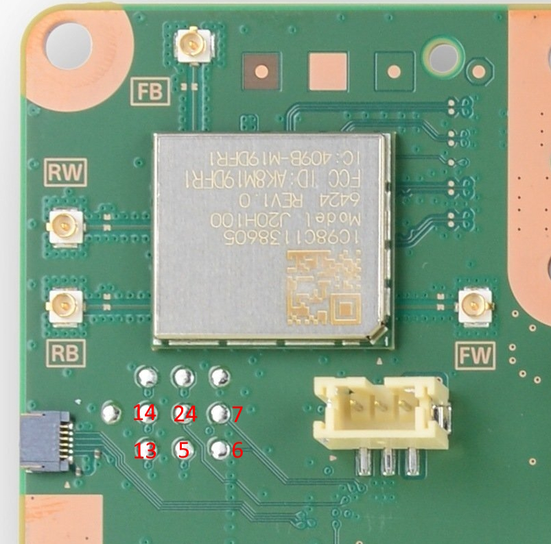

## 24 pin header near salina (EDM-010)
```
emc header
 1  5v
 2  5v
 3  gnd
 4  gnd
 5  emc gpio a1. pulling low at emc boot causes emc rom to enter uart shell @ 460800
 6  uart rx emc 115200
 7  uart tx emc 115200
 8  3v3, goes low when emc resets
 9  0v?
10  gnd
11  titania uart0 tx (efc fw: 460800, eap fw: 691200)
12  titania uart0 rx (efc fw: 460800, eap fw: 691200)
13  titania uart1 rx (bootrom: 460800, apu: 230400)
14  titania uart1 tx (bootrom: 460800, apu: 230400)
15  gnd
16  emc gpio c5 ("GPI SW" (only used if devif_det# active))
17  0v?
18  5v?
19  emc gpio a49 (devif_det#)
20  emc gpio a27. main power switch
21  i2c data (i2c_bus_4)
22  i2c clock (i2c_bus_4)
23  gnd
24  emc reset#

i2c_bus_4 contains mainly power management stuff:
(7bit addrs, 400khz)
1f      pca9557_gpioexpander    CP/dev only
2c      ad5272_nand             titania nand
2e      ad5272_g6_2             gddr6
2f      ad5272_g6_1             gddr6
51      rt5127_pmic             titania pmic
58      ds80pci102_redriver
64      rt5069_pmic             salina pmic. actually rt5126 (EDM-010) or da9081 (EDM-020) on ps5

emc gpio a 4,5,6,7(cs0:efc),8(cs1:floyd) - emc-efc spi bus (shared with floyd)

emc gpio a16 goes to rt5126 pin 13/rt5127 pin 44. set hi with pg2

emc gpio a29 - efc reset#
emc gpio a30 - titania bootmode (0: nand, 1: uart)
    to patch out emc's efc irq handler: emc.fcddr_write(0xa0113200, bytes.fromhex('7047'))
        prevents eventflg 8 being sent to task
    uart boot is on uart1 @ 460800.
    known cmds:
        info: prints "t2.0.100.041\nEC5E98BF84CC.C.1" from efc, "t2.0.100.043\nEC5E98BF84CC.C.1" from eap
        down: enters xmodem1k/crc
            0x03060000 when hdr.cpu is 0x99
        run: (sigchecks/decrypts?) downloaded data and execs
            0x030B0000 if called without doing down first
            0x06020000 if passed completely invalid data
            0x06020001 if hdr.cpu is 4. weird!!
            0x010100xx if hdr.cpu is not in (1,2,4). xx is hdr.cpu value (probably generic "invalid value" errorcode)
    unknown cmds return 0x030D0000
    errors get logged into "fw0" region of titania spi
        note: reading spi seems to kill rom
emc gpio a31 - titania cpu select (0: efc, 1: eap)
emc gpio a38 - efc to emc cmd irq (emc waits for it to be triggered after efc released from reset)

rt5126 - rt5127 connections
13      44  (emc gpio a16)
14      45
15      46
```

## titania rom error codes
the error codes on uart have format:
```
bits
31-28       cpu-origin
27-16       error major
15-0        error minor
```
typically the minor part of the error code is the offending value or e.g. register value to log.

### major codes
```
0x001   invalid rom checksum hi (cmd 1)
0x002   invalid rom checksum lo (cmd 1)
0x004   invalid ipcfifo src/dst cpu (read)
0x006   invalid ipcfifo src/dst cpu (write)
0x007   invalid ipcfifo register bank index
0x008   ipcfifo msg len too large (read)
0x009   ipcfifo msg len too large (write)
0x011   DFSR
0x012   IFSR
0x013   ADFSR hi
0x014   ADFSR lo
0x015   AIFSR hi
0x016   AIFSR lo
0x017   DFAR hi
0x018   DFAR lo
0x019   IFAR hi
0x01a   IFAR lo
0x201   expected ipcfifo 0x55
0x202   unknown ipcfifo cmd
0x203   failed to reply to cmd 1 (checksum). can only really happen if src/dst cpu are invalid.
0x204   minor 0: failed to read jump address. minor 1: failed to ack jump address.
0x205   failed to ack cmd 4, or wfi woke up.
0x206   (minor 0) __stack_chk_fail
0x207   (minor 3) __stack_chk_fail
0x30E   minor 1: timed out waiting to write byte to uart1
```

codes from bootrom
```
0x101   invalid hdr.cpu field value. minor is offending value.
0x306   trying to "down" image with hdr.cpu=0x99 and invalid other fields
0x30B   "run" without valid "down" state
0x30D   unknown uart command
0x602   image verification failure. minor 0: efc/eap, minor 1: bcm
```

## rom ipcfifo routing
rom only uses 6 of the ipcfifo banks (cpu0 <-> others). fw uses 12 (all <-> all)
```
src dst bank
    1   1
    2   3
    3   5
1       0
2       2
3       4
```
i.e
```
bank
0       1 -> 0
1       0 -> 1
2       2 -> 0
3       0 -> 2
4       3 -> 0
5       0 -> 3
```

## rom ipcfifo cmds
cpus 1-3 handle:
```
1   checksum-verify own rom
2   set SCTLR.V=0 and jump to address
4   wfi (ipcfifo cmd dispatch keeps running if woken)
```

## pico wiring
```
pico        emc header
1           6
2           7
3           4
4           5
5           24
11          12
12          11
```
`emc reset#` is used to detect liveness and reset emc in case of crash.

The button on the pico will reset it to flash mode.

Note: If you only want access to EMC, you can use connectors near bt/wifi module:  
  
(markings relate to "emc header" pinout, above)

## host pc setup
If `ENABLE_DEBUG_STDIO` cmake option is set, cdc interface 0 will be taken by pico sdk stdout/stdin. It's standard 115200 baud 8n1. Can be used for debugging pcio fw.

The other interfaces are emc and titania. The uart port settings (cdc line coding) for emc are ignored - the pico sets up actual uarts in proper way. For titania, baudrate is configurable from host.

Note:  
emc considers `\n` as end of cmd (configurable). echos input  
efc considers `\r` as end of cmd. echos `\r\n` for input `\r`

### salina (first interface)
The emc interface is line buffered on the pico. The pico takes care of checksums. Just send it normal umcd cmds in the form `<cmd> [args..]\n`. All data being sent to the host pc on this interface is framed so as to make writing client code easier (see `Result::to_usb_response`).

There are currently the following special cmds:
|cmd|notes|
|-|-|
| `unlock` | performs the emc exploit if needed |
| `picoreset` | resets the pico to flash mode |
| `picoemcreset` | reset emc via `emc reset#` |
| `picoemcrom` | reset emc into/out of rom (uart bootloader) mode and configure pico as needed |
| `picochipconst` | installs constants to use for an emc hw version |
| `picofwconst` | installs constants/shellcode to use for an emc fw version |

### titania (second interface)
This is just raw uart, data is just passed between host and titania bytewise as available.
